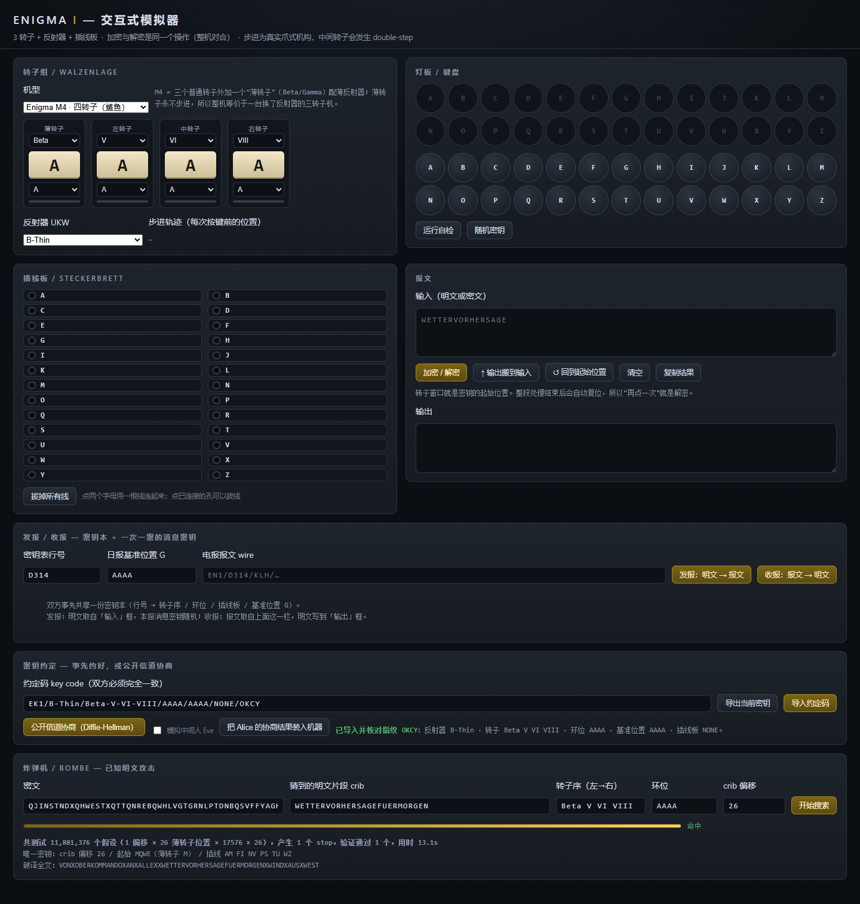

# Enigma I / M4 — 模拟器 / 炸弹机 / 报文协议

> 二战德军 Enigma I 与海军四转子 M4（"鲨鱼"）密码机的单文件网页模拟器，外加图灵-韦尔奇曼炸弹机的软件复刻、一套真正能把密文发给对方的报文协议，以及现代密钥协商的对照演示。
>
> 纯 Python + 原生 JavaScript，**零第三方依赖、零联网**。



---

## 这是什么

四层，逐层递进：

| 层 | 文件 | 做什么 |
|---|---|---|
| ① 密码机本体 | `enigma.py` / `index.html` | 3 转子（I–V）或 4 转子（M4，含薄转子与薄反射器）+ 反射器 + 插线板，步进用真实爪式机构（含 double-step） |
| ② 破译 | `bombe.py` / 页面内炸弹机 | 已知明文（crib）攻击：从一段猜到的明文反推转子位置与插线板；M4 用"反射器折叠"降回三转子问题 |
| ③ 通信 | `message.py` / 页面内发报收报 | 密钥本 + 每条随机的消息密钥 + 校验组，解决"密钥怎么送到对方手里" |
| ④ 密钥约定 | ~~页面内密钥约定面板~~（已从 UI 移除，概念见[概念速查](#概念速查原界面说明已从-ui-移除)） | 约定码 + 指纹校对；Diffie-Hellman 协商，以及中间人为什么能毁掉它 |

写它的动机很简单：Enigma 是少数几个**能在一台机器里同时看见密码学、机械工程和一段真实历史**的东西。而且它的每一个弱点都能被亲手复现——不是"据说它能被破"，是你自己跑一遍就破了。

M4 那一层尤其典型：布莱切利园在 1942 年整整十个月读不通"鲨鱼"，不是因为数学变难了，而是因为**搜索空间正好乘以 26**——薄转子多出来的那 26 个位置。这个"正好 26 倍"在页面上是可以亲手量出来的。

---

## 快速开始

### 网页版（推荐，什么都不用装）

双击 `index.html`，在浏览器里打开即可。单文件、无依赖、不联网、不上传任何数据。

> 注意：如果你的浏览器对 `file://` 有限制，用任意静态服务器打开也行，例如 `python -m http.server` 后访问 `http://127.0.0.1:8000/`。

> 想两个人互发密文？看带截图的新手流程：[docs/双人收发图文指南.md](docs/双人收发图文指南.md)。

### 命令行

```bash
python enigma.py          # 机器自检（10 项，含标准测试向量与 M4 不变量）
python bombe.py --all     # 三转子全量破译演示（约 45 秒）
python bombe.py           # 只看真偏移 + 两个假偏移
python bombe.py --m4      # M4 四转子破译演示（11,881,376 个假设，约 52 秒）
python message.py         # 发报 / 收报协议演示
python stepping_demo.py   # double-step 的转子轨迹
python check.py           # 转子序与环位偏移约定的四组合实验
python debug_bombe.py     # 炸弹机的判决性诊断（核心恒等式是否成立）
```

要求：Python 3.8+，**只用标准库**。

---

## 界面

| 面板 | 怎么用 |
|---|---|
| **转子字母窗** | 只显示"看得见"的部分：点大字母窗手动转一格（位置）；红条表示该转子正在缺口位 |
| **机械设置** | 机型、每个转子的型号与环位、反射器——真机上藏在机器内部、从字母窗看不见的设置。改这里不会动字母窗，但会改变加密结果，界面会回显"已生效" |
| **灯板 / 键盘** | 真机式操作：按一个键，亮的是**另一个**字母。点屏幕键盘或直接敲物理键盘都行 |
| **插线板** | 点两个字母连一根线（Steckerbrett），点已连接的孔拔线 |
| **报文** | 整段文字贴进去点「加密 / 解密」。同一个按钮兼作解密（整机对合），处理完转子自动复位；还有「↑ 输出搬到输入」一键往返 |
| **发报 / 收报** | 填密钥表行号、基准位置 G，明文→报文 或 报文→明文；带 3 字母校验组，密钥不对会明确报错。「密钥本导出/导入」把 反射器+转子序+环位+插线板+基准G 打包成一串带 4 位指纹的码，对方粘进去一键还原全部设置 |
| **炸弹机** | 填密文、crib、转子序（3 个或 4 个，如 `Beta V VI VIII`）、环位 → 开始搜索。可只搜一个 crib 偏移。分片执行、带进度条：三转子约 10 秒，M4 因搜索量 ×26 约 13 秒/偏移 |

## 概念速查（原界面说明，已从 UI 移除）

界面刻意保持精简，下面这些"是什么 / 为什么"的说明不再显示在页面上，统一放在这里。

### 机器是怎么转的
- **3 转子 + 反射器 + 插线板**：信号从右转子进、穿过三个转子、经反射器折返、再倒穿回来，最后过插线板。
- **加密与解密是同一个操作（整机对合）**：反射器和插线板都是对合的，所以同一台机器、同一起始位置，把密文再输一遍就得到明文。
- **步进是真实爪式机构**：不是三转子同步进位。中间转子在缺口位时，中间和左转子一起走（double-step）；否则右转子在缺口位时中间转子走；否则只有右转子走。所以转子周期是 26×25×26 = 16900，而不是 26³ = 17576。

### 字母窗 vs 机械设置
- **字母窗**显示的是转子**当前位置**，点它会前进一格；它也是整段加解密的**起始位置（密钥）**。
- **机械设置**（机型 / 型号 / 环位 / 反射器）是真机上藏在机器内部、从字母窗看不见的设置。改它们不会动字母窗，但会改变加密结果。
- 整段「加密 / 解密」处理完转子会**自动复位**到起始位置，所以"再点一次"就是解密。

### 发报 / 收报的密钥怎么送
- 双方事先共享一份**密钥本**（行号 → 转子序 / 环位 / 插线板 / 基准位置 G），必须另行安全送达。
- 发报：明文取自「输入」框，本报的**消息密钥随机**生成，用基准位置 G 加密后放进报文；正文用消息密钥加密。
- 收报：报文取自该栏，先解出消息密钥再解正文，明文写到「输出」框；3 字母校验组不对会明确报错。

### 已被移除的「密钥约定」面板
网页版早期有一个**密钥约定**面板：把整套日报密钥打包成约定码、末 4 位是指纹供双方口头核对；还能一键跑 **Diffie-Hellman** 在公开信道协商密钥，并可勾选**模拟中间人 Eve**，看没有认证时协商如何被拆散。因界面精简，DH 与中间人演示已从 UI 移除（概念保留在此）；其中**约定码导出/导入**因为正是"双方同步密钥本"的刚需，已以更精简的形式回归为「发报 / 收报」面板里的**密钥本导出/导入**。

---

## M4 四转子（鲨鱼）

### 它比 M3 多了什么

| | M3 / Enigma I | M4（Triton，1942） |
|---|---|---|
| 转子 | I–V，单缺口 | I–VIII（VI–VIII **双缺口**）+ 第四个**薄转子** β/γ |
| 反射器 | B / C | 薄反射器 **b Dünn / c Dünn** |
| 密钥空间 | 3 转子 | 3 转子 + 薄转子 26 个位置 |
| 步进 | 三个转子都动 | **薄转子永不步进**（它没有缺口，也没有棘爪） |

### 关键结构事实：薄转子可以折进反射器

薄转子在整个加密过程中一动不动，所以对它所在的某一天而言：

```
薄转子 ∘ 薄反射器 ∘ 薄转子⁻¹   ← 这就是一个固定的、新的反射器
```

于是 **M4 在结构上等价于一台换了反射器的三转子机**，26 个薄转子位置给出 26 个不同的等效反射器。这就是四转子炸弹机的全部思路：外层轮 26 次，内层跑现成的三转子搜索。`bombe.py` 和网页版都是这么实现的（`folded_reflector()` / `foldedReflector()`）。

这条性质还给了我们一个**可以证伪的交叉检验**：官方说明书写着，把薄转子 β 拨到 A 位、配上薄反射器 b，M4 就完全等同于一台 M3。于是

```
folded_reflector("Beta", "A", "A", "B-Thin")  ==  REFLECTORS["B"]      ✔ 逐位相同
```

这一条把**两批独立公布的常量**（Tony Sale 的布线表 + Crypto Museum 的用法说明）钉在了一起——任一处抄错都会立刻暴露。它同时是自检的第 9、10 项。

### 数据来源

这次我没有相信记忆。所有转子布线与缺口位置都取自在线权威规格页：

- [Tony Sale（布莱切利园博物馆原馆长）：The Enigma Rotors](https://www.codesandciphers.org.uk/enigma/rotorspec.htm) — 转子 VI–VIII、β、γ 的布线，以及换档点（I–V 在 R/F/W/K/A，VI–VIII 在 A 和 N）
- [Crypto Museum：Enigma M4](https://www.cryptomuseum.com/crypto/enigma/m4/index.htm) — M4 的用法、TRITON/NEPTUN 通信网，以及 M3 兼容模式（薄转子置 A + 薄反射器 b）

**我记忆里的 β 布线是错的**（我"记得"是 `LEAVGADR…`，真实值是 `LEYJVCNIXWPBQMDRTAKZGFUHOS`）。如果按记忆写，自检第 9 项会立刻失败——这正是把不变量写成断言的价值。

### M4 破译实测

```
真实密钥: 薄转子 Beta 在 M 位 · 核心起始 QWE · 环位 AAAA · 插线 6 对
搜索量:   11,881,376 个假设（26 个薄转子位置 × 17576 × 26）

Python:  1 个 stop，验证通过 1 个，51.5s
网页:    1 个 stop，验证通过 1 个，13.1s
→ 命中！完整起始位置 MQWE（薄转子 M），恢复插线 AM FI NV PS TU WZ
→ 破译全文: VONXOBERKOMMANDOXANXALLEXXWETTERVORHERSAGEFUERMORGENXWINDXAUSXWEST
```

对照：同一段 crib，三转子只要 `17576 × 26 = 456,976` 个假设，**M4 正好是它的 26 倍**。当年布莱切利园就是被这 26 倍卡住的——数学没变难，算力不够。直到 NCR 造出约 120 台四转子炸弹机，加上缴获的天气短码本提供可靠 crib，才重新读通"鲨鱼"。

> 页面上想复现这个数字：机型选 M4，用 `EK1/B-Thin/Beta-V-VI-VIII/AAAA/AAAA/NONE/OKCY` 导入约定码，把 crib 偏移填 26（否则要把 26 倍再乘上 23 个偏移）。

---

## 正确性验证

**机器十项自检**（`python enigma.py`，网页上点「运行自检」跑的是同一套）：

```
[PASS] 标准向量 AAAAA              → BDZGO（期望 BDZGO）
[PASS] 对合性 E(E(x))=x            → WETTERVORHERSAGE
[PASS] 无不动点（不加密成自己）      26 字母 × 10 组设置
[PASS] 转子周期（double step）      → 16900 步回到 AAA（26³=17576）
[PASS] VI–VIII 双缺口 M/Z          I–V 单缺口，VI–VIII 两个
[PASS] 薄转子永不步进                跑完 26 个字母后仍在 A 位
[PASS] M4 转子周期（单缺口）         16900 步回到 AAAA
[PASS] 双缺口使步进不再是置换         轨道长度 4056，不回起点
[PASS] β@A + 薄反射器 b ≡ 普通 UKW B  折叠后的等效反射器与 UKW B 逐位相同
[PASS] 四转子跑出三转子结果          LOESSJBUJCKDWZMN…
```

第四项是真正的结构指纹：因为中间转子会连续走两步，转子周期是 26×25×26 而不是 26³。任何"三转子同步进位"的错误实现都会在这一项上翻车。

第八项是个意外收获：**缺口不止一个时，步进映射不再是置换**，从 AAAA 出发的轨道根本不回到 AAAA（实测轨道长度 4056）。我第一次写这条测试时把预期定成 16900，结果被测出失败——失败的是我的预期，不是代码。这解释了为什么 16900 这个"经典数字"只在单缺口转子上成立。

**炸弹机**（`python bombe.py --all`）：

```
共测试 10,510,448 个假设（23 个偏移 × 17576 × 26）
产生 stop: 1 个        验证通过: 1 个        用时: 43.2s
唯一密钥: 偏移 26 / 起始 QWE / 插线 AM FI NV PS TU WZ
密钥完全正确: True
破译全文: VONXOBERKOMMANDOXANXALLEXXWETTERVORHERSAGEFUERMORGENXWINDXAUSXWEST
```

一千多万个假设塌缩成唯一候选——炸弹机的价值不在于算得快，而在于让错误假设自己矛盾死掉。同一套算法在浏览器里跑只要 **10.0 秒**（JS 引擎比 CPython 快约 4 倍），结论完全一致。

**跨实现一致性**：网页版和 Python 版是两套独立实现，共用同一套布线与约定，并且被同一个标准向量钉住。协议层也做过交叉验证——Python 生成的报文给网页端收报：

```
Python 侧: 明文 WETTERVORHERSAGEFUERMORGEN
          报文 EN1/D314/CGC/QVFRRNRJAYUMBKMIELNKIJEXSINJT
网页侧:   密钥表行号 D314 · 基准位置 AAA → 解出消息密钥 QWE
          正文校验组 UTY，重算应为 UTY → 校验通过
          输出 WETTERVORHERSAGEFUERMORGEN        ✔
```

**M4 也做了同一套交叉验证**：Python 加密的四转子密文，交给网页版炸弹机独立破译——

```
Python 侧: 转子 Beta V VI VIII / 反射器 B-Thin / 环位 AAAA / 起始 MQWE / 6 对插线
           密文 QJINSTNDXQHWESTXQTTQNREBQWHLVGTGRNLPTDNBQSVFFYAGHWMKIUZPZSNYNVFACU
网页侧:    crib 偏移 26 → 11,881,376 个假设 → 1 个 stop → 13.1s
           起始 MQWE（薄转子 M）/ 插线 AM FI NV PS TU WZ
           破译全文 VONXOBERKOMMANDOXANXALLEXXWETTERVORHERSAGEFUERMORGENXWINDXAUSXWEST  ✔
```

两套实现（Python 与 JavaScript）在四转子折叠、双缺口步进、薄转子不步进这三处细节上完全一致——只要有一处理解不同，破译结果就对不上。

**反例也验证过**：故意多插一根线（模拟拿错密钥本），解出的是 `WETTEKVORPERSBGEFUERMORGEN` 这种"看着挺像德语"的乱码，但校验组立刻拦下：

```
正文校验组 UTY，重算应为 WTI → 校验不通过
```

这正是 Enigma 本身缺失的东西：它没有任何完整性保护，收报方拿到乱码也无法判断是密钥错了还是报文被改了。

---

## 报文协议规范

### 电报格式

```
EN1 / <密钥表行号> / <密钥块> / <正文>

密钥块 = Enigma(日报密钥, 起始 = G).加密(M)              ← M 是本报随机的 3 字母消息密钥
正文   = Enigma(日报密钥, 起始 = M).加密(V ‖ 明文)        ← V 是 3 字母校验组
```

实例：

```
密钥本 D314 行：反射器 B / 转子 I II III / 环位 AAA / 基准位置 G = AAA / 无插线
消息密钥 M = QWE（随机）→ 用 G 加密成密钥块 CGC
明文 WETTERVORHERSAGEFUERMORGEN 的校验组 V = UTY
报文：EN1/D314/CGC/QVFRRNRJAYUMBKMIELNKIJEXSINJT
```

### 校验组算法

与网页版逐位一致，可直接照抄实现：

```
a, b, c = 7, 11, 13
for i, ch in enumerate(明文中去掉非字母并转大写):
    v = ord(ch) - 65
    a = (a*31 + v)     % 26
    b = (b*17 + v + i) % 26
    c = (c*7  + v*(i+1) + 5) % 26
V = chr(a+65) + chr(b+65) + chr(c+65)
```

### 密钥约定码

```
EK1 / <反射器> / <转子序> / <环位> / <基准位置> / <插线板> / <指纹>

实例：EK1/B/I-II-III/AAA/AAA/NONE/MGLU
```

指纹是对 `反射器/转子序/环位/基准位置/插线板` 这段规范文本做 4 轮滚动哈希得到的 4 个字母，用途是**人工核对**——双方在另一条信道上念一遍，就能确认没有抄错、也没有被掉包。

### 收发三步

| 步骤 | 发报方 | 收报方 |
|---|---|---|
| 1 | 按行号取出当日的反射器 / 转子序 / 环位 / 插线板 / 基准位置 G | 同左（同一份密钥本） |
| 2 | 随机取消息密钥 M，用起点 G 加密 M 得密钥块 | 用起点 G 解密密钥块得 M |
| 3 | 用起点 M 加密「校验组 ‖ 明文」，拼成报文发出 | 用起点 M 解出「校验组 ‖ 明文」，校验通过才算收到 |

**与历史做法的两处差异**（这是刻意的设计选择）：

1. **消息密钥只加密一次**。历史上是双重加密（塞在 6 字母报头里），而那个重复正是 Rejewski 1932 年反推全部转子布线的入口。去掉它，那条攻击路径就断了。
2. **增加了校验组**。历史上没有，收报方收到乱码无法判断是密钥错了还是报文被改了。

---

## 文件清单

| 文件 | 说明 |
|---|---|
| `index.html` | **交互界面**：机器（M3/M4）+ 发报收报 + 密钥本导出/导入 + 炸弹机，全在一个文件里 |
| `enigma.py` | 密码机本体（Enigma I / M4，可当库用）+ 十项自检 + `folded_reflector()` |
| `bombe.py` | 炸弹机：crib 拖动、菜单传播、stop 验证、M4 反射器折叠；`--all` 全量扫描，`--m4` 四转子演示 |
| `message.py` | 报文协议参考实现，用于与网页版交叉验证 |
| `stepping_demo.py` | double-step 轨迹演示（ADU→ADV→AEW→BFX→BFY） |
| `check.py` | 转子序方向 × 环位偏移符号的四组合实验，用来定死约定 |
| `debug_bombe.py` | 判决性诊断：验证核心恒等式 `P(cᵢ) = Sᵢ(P(pᵢ))`、菜单连通性、真密钥是否在 stop 里 |
| `ui-screenshot.png` | 界面截图 |

---

## 工程笔记：踩过的五个坑

写这个东西的过程中我错了五次，都值得记下来：

**1. 转子序的书写方向。** 我按"列表第一个是右转子"实现，标准向量给出 `FTZMG` 而不是 `BDZGO`。`check.py` 用"转子序方向 × 环位偏移符号"四组合一跑就定死了：**转子序按历史文档左→右书写，环位偏移取 `pos − ring`**。这是历史文档最容易读错的地方。

**2. 把"未插线"当成了非法状态。** 炸弹机的传播里，我跳过了 `guess == input_letter` 这个假设，又把传播出的不动点当成矛盾删掉——但"某字母根本没插线"本来就是合法的 26 种假设之一。结果就是真密钥根本不是 stop，同一个偏移下有 11 个 stop 却一个都验不过。修好之后：**11 个 stop 变成 1 个，命中**。

**3. 诊断脚本自己多走了一步。** 第一次跑诊断时报告"转子变换与真机有 400 处不一致"，其实是我的诊断代码在比较循环里多步进了一次。真机与搜索器的变换本来就是 0 处不一致。**诊断工具本身也要被怀疑。**

**4. 界面把"有状态的机器"直接接到了"整段处理"按钮上。** 用户反馈"解密不了"——不是算法错（自检第 2 项就是双次加密还原），是整段加密后转子停在了末尾，第二次点击从错误的起点开始。改成**纯函数**（处理完自动复位）+ 输出替换而非追加 + 加「↑ 输出搬到输入」按钮。**对合性只在"两次从同一个起始位置开始"时才等于可逆。**

**5. 大写化把 `Beta` 变成了 `BETA`。** 约定码会被整体转成大写（历史报文本就全大写），但薄转子的名字是混写的 `Beta` / `Gamma`，反射器是 `B-Thin`。于是 `ROTORS["BETA"]` 查不到，导入 M4 约定码时被判成"不合法的转子"。同一个坑在炸弹机的转子序输入框里又踩了一次。修法是在**所有外部输入入口**做大小写不敏感查表（而不是改用全大写常量名，那样约定码会变得难读）。**规范化要放在边界上，且只能有一处。**

---

## 局限与安全声明

**这是教学与演示项目，不要用于真实的保密通信。**

- **校验组不是 MAC**。它挡盲改和密钥错误，误接受率 1/26³ ≈ 1/17,576；挡不住有构造能力的对手。
- **DH 演示是玩具级参数**：61 位素数（2⁶¹−1）、零认证。真用需要 2048 位以上或椭圆曲线、认证机制、正式的密钥派生函数，并防小群攻击。页面上的「中间人 Eve」开关就是为了让你亲眼看到省略认证的后果。
- **密钥本一旦被缴获，当天全部可读**。历史上正是如此——缴获密钥材料（如 U-110、U-559）比纯粹的数学破译更致命。
- **覆盖范围有限**：只有 A–Z 字母；没有实现后期的 Uhr 插线盒，也没有实现 Kenngruppen 之类的程序性细节；炸弹机只搜起始位置，**环位 Ringstellung 未纳入搜索空间**。
- **M4 的 26 倍是真实的**：搜索量随薄转子精确乘 26，全偏移扫描要几分钟——这是当年需要上百台机器的原因，不是实现效率问题。
- 网页版只处理英文/拼音字母，中文会被自动丢弃——Enigma 本来也没有这个能力。

---

## 想继续挖的话

几个方向（都能在这个项目上接着做）：

- **Rejewski 1932**：不用已知明文，靠指示规程里 6 字母组的重复，分析 `A·B·C` 置换的轮换结构反推全部布线。
- **Banburismus**：用 I/L/M/N 四个字母做序贯贝叶斯统计，先把转子序砍到只剩几种。
- **环位搜索**：把 Ringstellung 纳入炸弹机的搜索空间（现在只搜起始位置），M4 的四字母环位会让搜索空间再涨 26⁴ 量级——这才是"必须用贝叶斯先验砍空间"的地方。
- **Zygalski 穿孔纸**：用一张纸同时检验所有转子序，把 1938 年的 60 倍工作量压回可接受范围。

检索关键词：`Enigma rotor wiring`、`Ringstellung`、`Grundstellung`、`Spruchschlüssel`、`Steckerbrett`、`cryptologic bomb`、`crib dragging`、`Banburismus`、`Zygalski sheets`。

---

## 致谢与数据来源

- **中国科大词元计划**： We appreciate the Supercomputing Center of USTC for providing high-performance AI infrastructure services.
- **转子布线与反射器规格**：依据公开历史资料整理，主要参考 Tony Sale 的转子规格页 [codesandciphers.org.uk/enigma/rotorspec.htm](https://www.codesandciphers.org.uk/enigma/rotorspec.htm) 与 [Crypto Museum](https://www.cryptomuseum.com/crypto/enigma/) 的公开档案。这些布线是历史事实，不属于任何人的版权。

---

## 许可证

本项目以 **MIT License** 发布，详见根目录的 [`LICENSE`](LICENSE)。可自由使用、修改、分发与商用，保留版权与许可声明即可。

