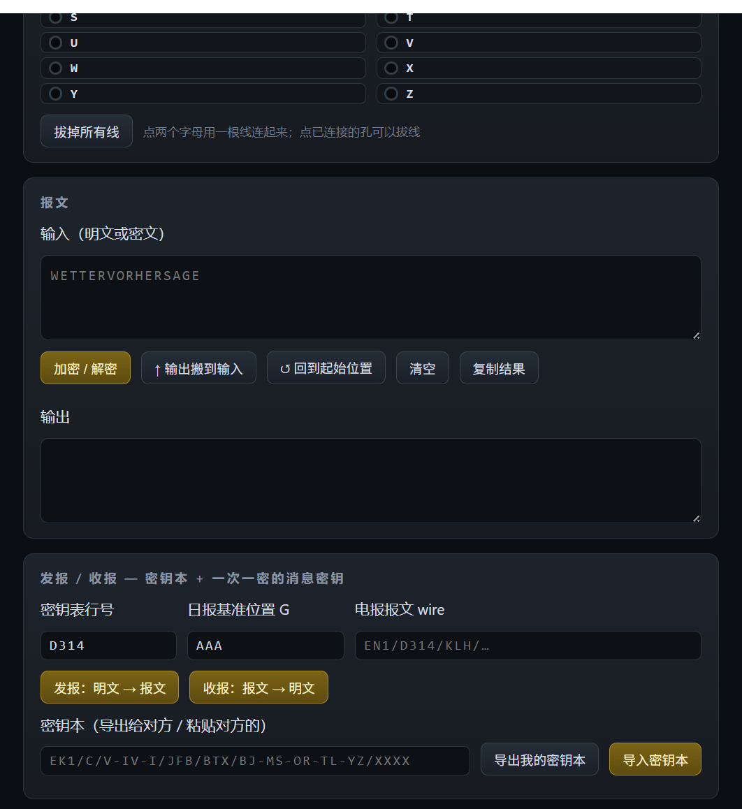
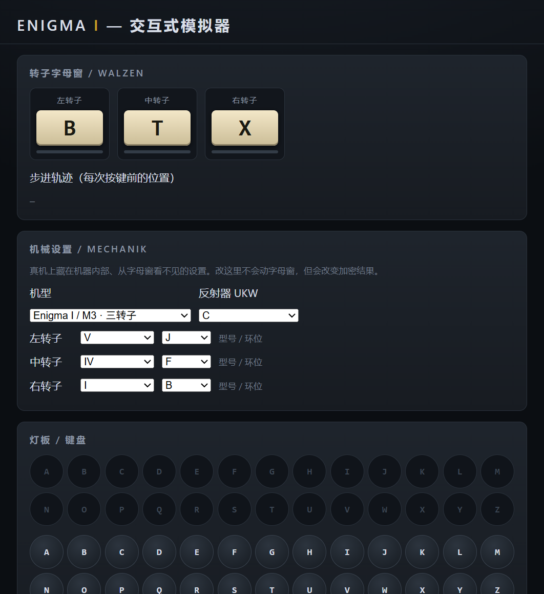
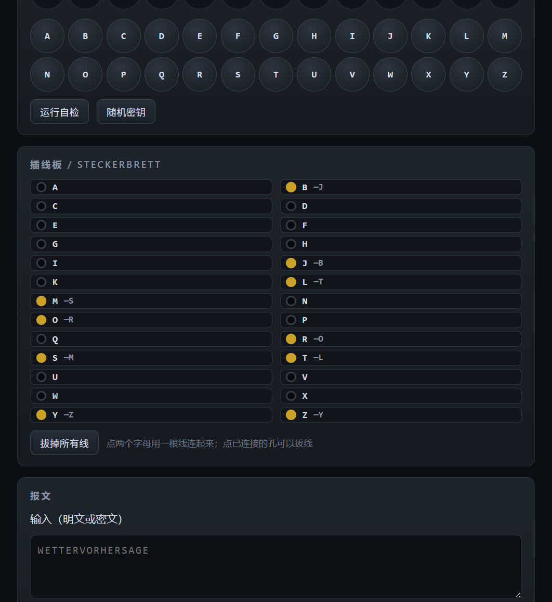
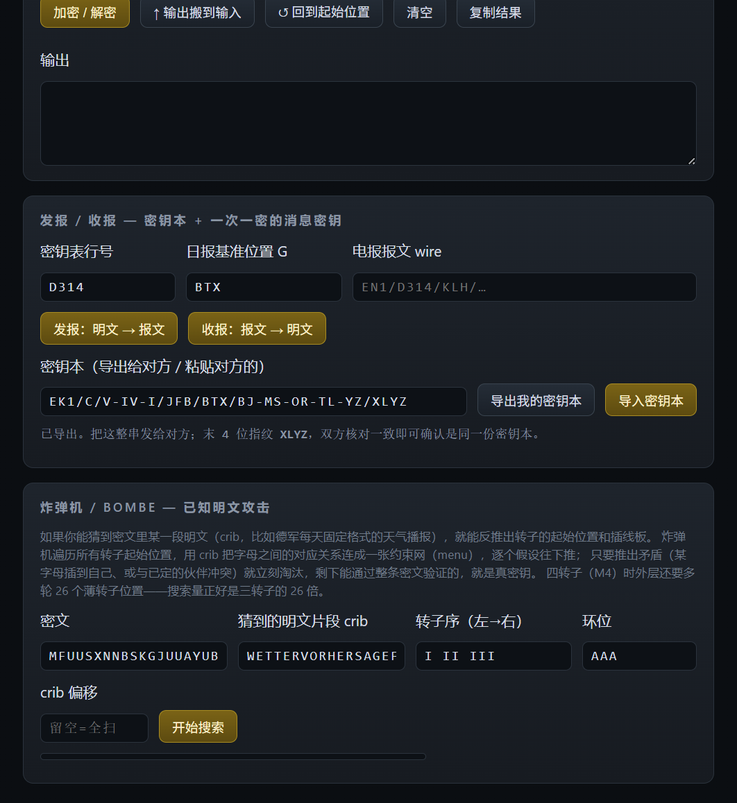
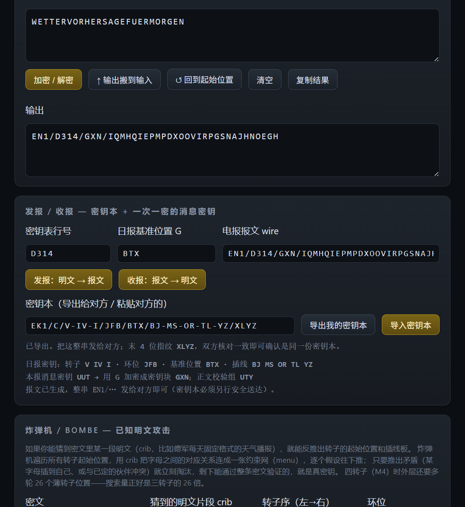
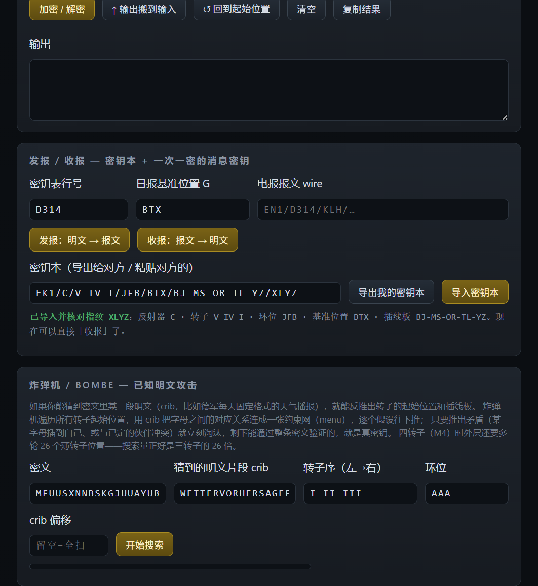
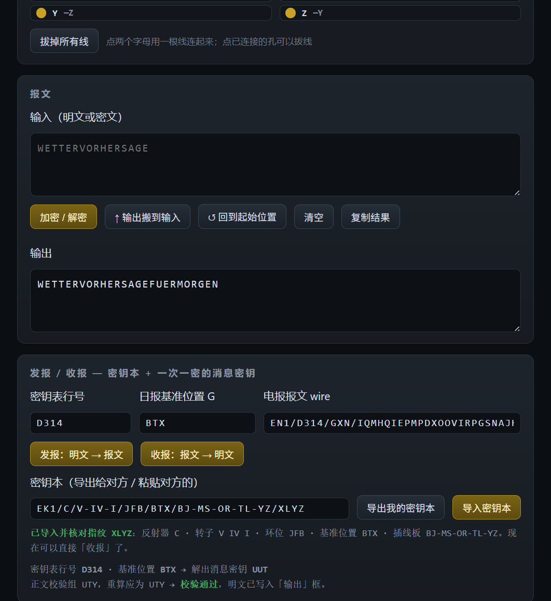

# 双人收发图文指南(小白版)

> 目标:两个人各开一个网页,一个人加密说话,另一个人解密听懂。
> 全程只需要互相发**两样东西**:一份「密钥本」码 + 一条「报文」。别的都不用。

先记住一句话:**报文里不含密钥**。所以收发双方必须先拿到**同一份密钥本**,否则永远解不开。本指南就是教你怎么同步密钥本、怎么收发。

---

## 角色约定

- **发信人(甲方)**:要说话的人。
- **收信人(乙方)**:要听的人。
- 两人都打开同一个网页 `index.html`(双击即可,不用装任何东西、不联网)。

下面用一套**示例密钥本**走完全程,你照抄即可:

| 项目 | 示例值 | 在哪填 |
|---|---|---|
| 机型 | Enigma I / M3(三转子) | 机械设置 |
| 转子型号(左/中/右) | V / IV / I | 机械设置 |
| 环位(左/中/右) | J / F / B | 机械设置 |
| 反射器 | C | 机械设置 |
| 插线板 | BJ MS OR TL YZ | 插线板面板 |
| 日报基准位置 G | BTX | 发报/收报 |

---

## 第 0 步:认识界面

打开网页,从上到下是:**转子字母窗**(会转的大字母)、**机械设置**(藏起来的配置)、**灯板/键盘**、**插线板**、**报文**(输入输出框)、**发报/收报**(密钥本 + 报文)。



你**不需要**懂每个零件。本流程只用到:**机械设置、插线板、发报/收报** 三块。

---

## 第 1 步(甲方):配好密钥本

在「机械设置」里把 机型 / 转子型号 / 环位 / 反射器 调成约定值:



再到「插线板」点字母两两连线,连成约定的 `BJ MS OR TL YZ`(点一个字母再点另一个即连上;点已连的孔可拔线):



> 偷懒办法:其实第 1、2 步可以合并——直接看第 2 步的「导入」。手动配只是为了让你明白密钥本长什么样。

---

## 第 2 步(甲方):导出密钥本,发给乙方

在「发报/收报」面板,点「**导出我的密钥本**」,输入框会出现一串码:

```
EK1/C/V-IV-I/JFB/BTX/BJ-MS-OR-TL-YZ/XLYZ
```



把这**整串**通过微信/邮件/口头抄写发给乙方。末尾 4 位 `XLYZ` 是**指纹**:双方核对一下这 4 个字母是否一致,就能确认没抄错、没被人掉包。

---

## 第 3 步(甲方):写明文,发报

在「报文」的**输入**框写要说的话(只认 A–Z,空格标点自动忽略),回到「发报/收报」点「**发报:明文 → 报文**」,「电报报文 wire」框里就生成了报文:

```
EN1/D314/GXN/IQMHQIEPMPDXOOVIRPGSNAJHNOEGH
```



把这条报文发给乙方。**每条新消息都重新点一次发报**,消息密钥会自动换,不要复用旧报文。

---

## 第 4 步(乙方):打开全新网页,导入密钥本

乙方打开一个**全新的**网页(默认空配置),在「发报/收报」的「密钥本」框里粘贴甲方发来的那串码,点「**导入密钥本**」:



看到绿色「**已导入并核对指纹 XLYZ**」就成功了——机械设置、插线板、基准位置 G 已全部自动还原成和甲方一致。**这一步只做一次**,之后不用重复。

---

## 第 5 步(乙方):粘贴报文,收报

把甲方发来的报文粘进「电报报文 wire」框,点「**收报:报文 → 明文**」。明文会出现在「报文」面板的**输出**框,并显示绿色「**校验通过**」:



完成。乙方听到了甲方说的话。

---

## 常见问题

**Q:为什么乙方必须导入密钥本?直接收报不行吗?**
不行。报文里只有"行号 + 加密过的消息密钥 + 密文",真正的密钥(转子/环位/反射器/插线板/基准G)不在报文里。配置对不上时,网页会解出一堆乱码并明确报「校验不通过」,这是正常的保护,不是坏了。

**Q:指纹(XLYZ)是干嘛的?**
防止密钥本在传递中被抄错或篡改。双方各自看一眼末 4 位,一致才继续通信。

**Q:密钥本要多久换一次?**
历史上是"一天一页"。你自己用的话,想换就换:改配置后重新「导出」发对方一次即可。每条报文的消息密钥是自动一次一换的,不用你管。

**Q:输入中文/空格/标点会怎样?**
自动忽略,只加密 A–Z 字母。想发中文就先自己翻译成字母(比如拼音)。

**Q:想自己玩加密解密(不发给别人)?**
在「报文」输入框写明文点「加密/解密」,再点「↑ 输出搬到输入」再点一次,就还原了——因为加密和解密是同一个操作。
